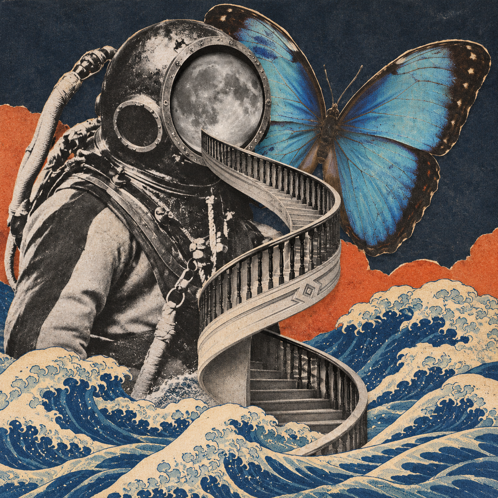
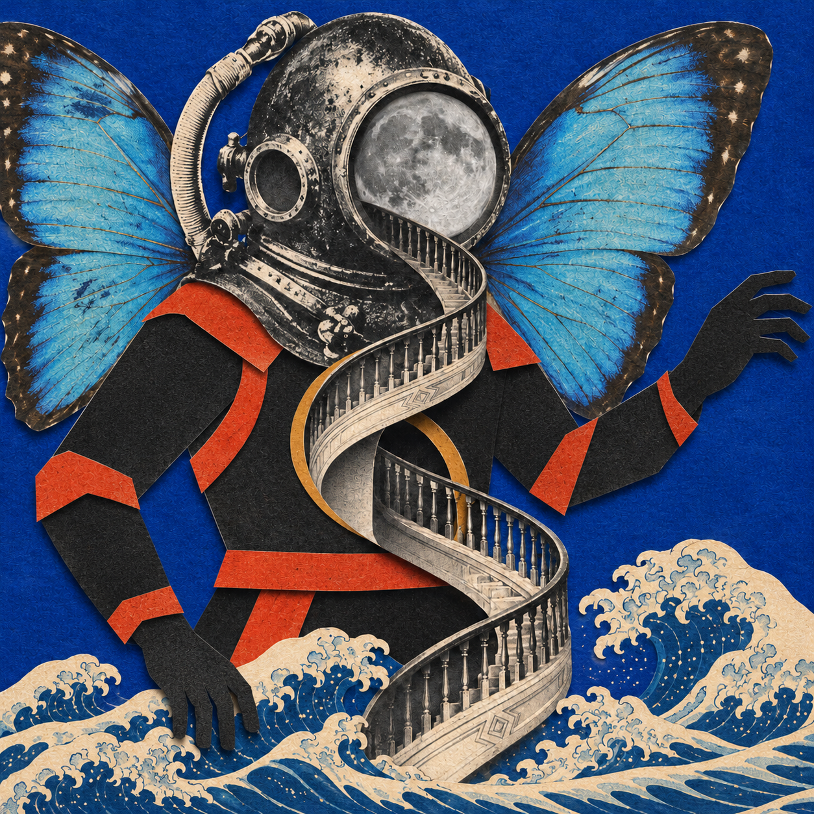

# 怪诞复古拼贴

一个让 Agent 先询问画面元素，再上网找图、检查素材并生成怪诞复古拼贴的 Skill。

默认采用摄影杂志拼贴：保留照片细节，用硬边剪切、夸张比例和旧印刷质感连接不同来源的图像。画面默认无字，参考截图中的字幕、手机界面和播放按钮不会作为画面要求。



示例元素：老式潜水员、蝴蝶、月球、旋转楼梯、海浪。它们只是本次实验的题材，使用 Skill 时由用户决定元素。

## 使用

将整个仓库目录放进 Agent 支持的 Skill 目录，保留 `SKILL.md`、`assets`、`references` 等文件的相对位置。也可以让 Agent 直接读取仓库中的 `SKILL.md`。

示例请求：

```text
使用 $weird-vintage-collage，先问我想放哪些元素，
再找图，按摄影杂志拼贴风格做一张无字画面。
```

Agent 需要联网搜索和图像生成/编辑工具。下载脚本可选，用于保存已选图片、来源、尺寸、校验值和素材图板；它本身不负责搜索或出图：

```bash
uv run --with pillow python scripts/fetch_sources.py examples/sources.input.json --out output/research --sheet
```

也可在已有 Pillow 的 Python 环境运行。脚本要求新的输出目录，已有清单和图片不会被覆盖。

## 可选分支

除默认的摄影杂志拼贴，还支持装饰性标本剧场和剪纸偶戏。下图为同一组元素的剪纸偶戏实验，身体用平面纸片处理，头盔和楼梯保留细节。

<details>
<summary>查看 B：平面剪纸偶戏</summary>



</details>

## 文件

| 文件 | 用途 |
|---|---|
| [SKILL.md](SKILL.md) | Agent 的操作入口 |
| [assets/style-reference-a.png](assets/style-reference-a.png) | 默认视觉基准，只借视觉语言，不照搬题材 |
| [references/style-grammar.md](references/style-grammar.md) | 三个视觉分支与常见偏差 |
| [references/prompt-template.md](references/prompt-template.md) | 图像输入标注与提示词模板 |
| [scripts/fetch_sources.py](scripts/fetch_sources.py) | 下载素材并保存来源与核对图板 |
| [examples/sources.input.json](examples/sources.input.json) | 示例素材来源及下载输入 |
| [examples/README.md](examples/README.md) | 示例说明、来源署名与验证范围 |

默认流程采用参考图片重组的生成式拼贴，模型会重绘局部。输出为平面成图，原图像素保留或可编辑图层需要另行采用相应的合成流程。
